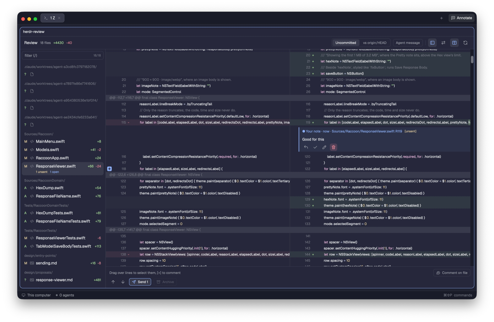

# herdr-review

A review panel that opens to the right of the pane where your coding agent runs. It lists the files changed in the
folder that pane is in, shows every file's diff in one scrolling stream, and lets you comment on lines and send the
comments to the agent as one prompt. The agent answers from its own shell, and the panel updates by itself.

Needs git, macOS or Linux, and was tried on herdr-app 0.1.14. Claude Code is the only agent it can send to.

## Install

Do these in order. Read every file in this folder first.

1. Tell the person this mod runs programs: it starts `herdr-review` (which runs `git` and `hc`), `mkdir` and `chmod`
   for its scratch folder, and writes under `<app home>/data/herdr-review`. It does not use the network. Only the
   binary download in step 4 does.
2. Copy `mods/herdr-review/` to `<app home>/mods/herdr-review/`. `<app home>` is `$HERDR_APP_HOME`, else
   `~/.config/herdr-app`. Leave `RECIPE.md` and `preview.png` out. If that folder exists, this is an update: replace
   its files and keep `bin/`.
3. Merge `keys.json` into the person's `keys.json` under `global`. If `cmd-shift-r` is already used, ask which key to
   use and use it in the `command` entry. Never edit another key.
4. Run `bash <app home>/mods/herdr-review/fetch-binary.sh`. It downloads the `herdr-review` binary of the version in
   `mods/herdr-review/VERSION` from this repository's GitHub release, checks its sha256 and puts it at
   `mods/herdr-review/bin/herdr-review`. It does nothing when that version is already there.
5. Run `herdr-app check <app home>/mods/herdr-review`.

The mod folder keeps its name `herdr-review`. The key binding names it. If the name is taken, rename the folder and
the `mod` value in the key together.

## Update

Do steps 2, 4 and 5 again with the newer folder. An agent may replace the files of an existing `mods/herdr-review/`
(it is this mod's own folder, not someone else's).

## What you see

The header has the title, the number of changed files with `+added -removed`, the diff choices `Uncommitted` and
`vs <base>`, `Agent message`, layout buttons, and a refresh button. Under it, on the left, a file list grouped by
folder with a filter box. On the right, all diffs in one stream, side by side when the panel is at least 900 px wide,
with comment cards under their lines. A bar at the bottom holds `Send N`, `Archive` and `Comment on file`.

## How it behaves

- Hover a line to see `[+]` at its left. Click it to comment. Drag over lines first to comment on a range.
- A comment starts `unsent`. `Send N` sends all unsent comments to the agent in that folder as one prompt. With
  more than one agent, the bar lists them and you pick one.
- A card has reply, resolve and, for your own comments, edit and delete buttons. A thread the agent resolved shows `new`
  until you look at it. `Archive` moves resolved threads out of the way.
- `Agent message` shows the agent's last message instead of the diff, for commenting on its lines.
- The panel reloads when the repository or the review state changes, and every 10 seconds.
- Keys: `j` `k` move, `c` comments, `v` selects a range, `/` filters files.

## Built from

- `mods/herdr-review/main.js`, one bundle, with `mod.json` (`place` `none`, `focusable`).
- The `herdr-review` binary, called with `state`, `file`, `send`, `archive`, `message` and `theme`. The review itself
  lives there, in files outside the repository. The panel holds no review logic.
- The `herdr` functions `exec`, `focused`, `panes`, `watchFolder`, `readTextFile`, `writeTextFile`, `appHome`, `theme`.
- `icons/*.svg` for file types and buttons.

## Watch out

- Outside a git repository the panel shows `not a git repository` and opens no review.
- It runs the staged `bin/herdr-review` first, then `herdr-review` on `PATH`. An old `PATH` copy shows
  `update herdr-review`.
- With no binary the banner says so and prints the fetch command. Refresh loads again after it.
- A frame can lag a change by a moment.

## Done when

- `herdr-app check <app home>/mods/herdr-review` passes.
- `<app home>/mods/herdr-review/bin/herdr-review state --json --repo <a git folder>` prints JSON.
- Focus a pane in a git repository with changes and press the key. The panel opens to its right and lists the files.
